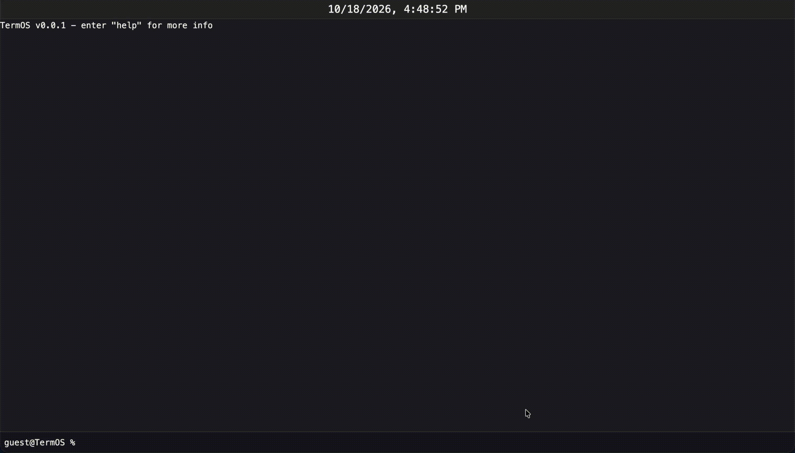

	<h1>TermOS</h1>
	<picture>
		
	</picture>
	<h3>What if the terminal is the OS and much more than a terminal?</h3>

> [!NOTE]
> TermOS is currently in alpha. Some features may not be complete!

## Quick Start
Try TermOS [here!](https://brandonfglx.github.io/TermOS)

## Features
 - alias: toggles aliases to commands; aliases are used if a command doesn't exist
 - clear: clears the terminal
 - echo: outputs characters to stdout
 - eval: evaluates the command during runtime
 - files: access files in a virtual file system and save it in LocalStorage
 - goto: go to a website on the world wide web
 - help: shows the help menu
 - info: get device info
 - loc: prints info about the user's location or about the zip code
 - search: search the web with any search engine
 - term: core terminal for TermOS
 - text: a basic text editor
 - weather: shows the weather

## Technicals
The entire "operation system" is created with Svelte, TypeScript, TailwindCSS, and some custom CSS. Svelte is used with bun to create a comprehensive development and build experience. Svelte's interactivity allowed the OS to behave immediately and react to changes to the user's keyboard inputs.

TermOS is split into two distinct executable programs: [Commands]() and [Applications](). 
 - Commands can only be interacted with using the [Terminal]() and the terminal input that is always present at the bottom of the viewport. Use `help` to list all available commands and use `help [command]` to get information about a specific command. The terminal is similar to any UNIX-like terminal. Applications can only be launched via their respective command. 
 - There is no traditional Desktop, rather the user switches between applications, with the terminal being the "core" application. Applications take up most of the viewport, with all GUIs generated by the application. Applications usually has a corresponding command with the ability to launch such application and provide basic, non-GUI funcions (see [TextApp]()).

Instead of using `<input>`, TermOS contains its own [KeyboardManager]() that captures input from the user and directs it to the active (or default) [KeyboardListener](). Additionally, the active `KeyboardListener` changes depending on where the user's focus is: clicking on an app then to the terminal input at the bottom of the viewport will change the focus.

## Acknowledgements
 - Svelte Documentation - Assisted in the setup process and converting it into a static webpage using `adapter-static` and information about dynamically importing TypeScript files
 - TailwindCSS Documentation - Assisted in finding corresponding CSS tags

## License
TermOS is licensed under the [GNU General Public License Version 3](./LICENSE).